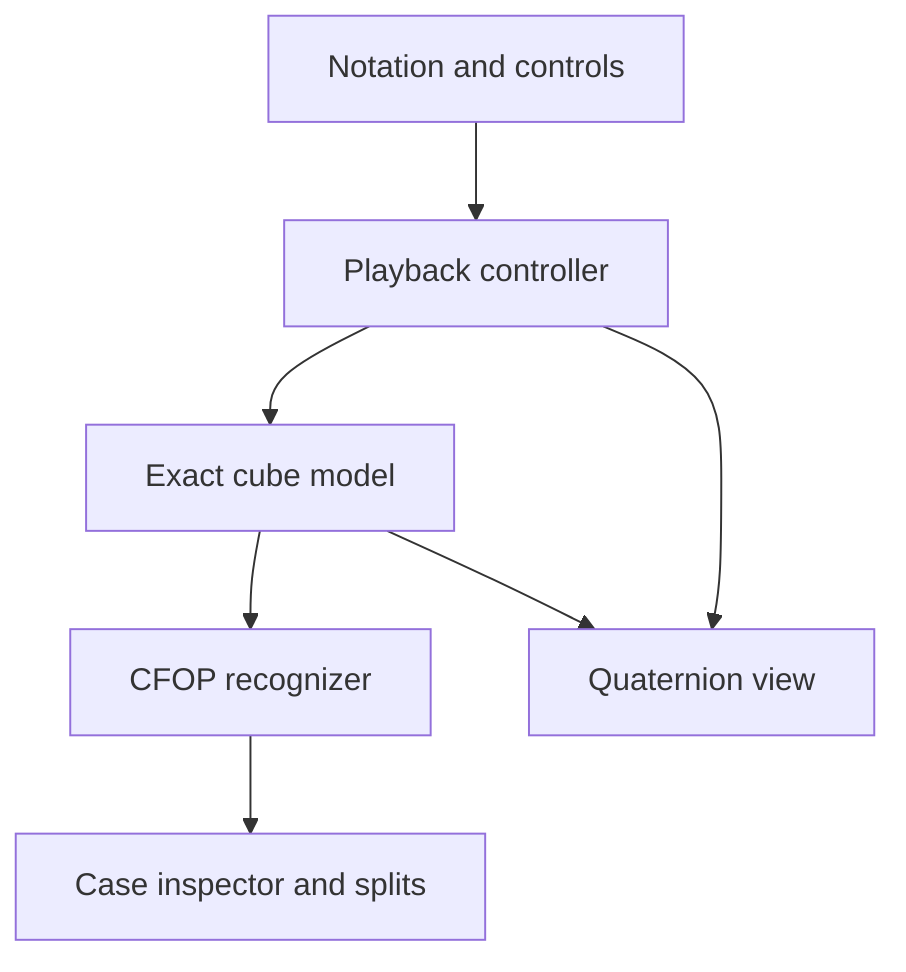

# Exact-state CFOP trainer architecture

## 1. Model, recognition, controller, view

The model is authoritative. A move parser emits typed commands; the playback controller owns the model and commits one command per completed turn. CFOP recognition observes committed snapshots. The Three.js view receives the committed cube, the pending move and a normalized progress value. Mesh transforms are never read back into the model.



`Cube.facelets` returns a defensive copy. The controller returns cloned cubes and split records. A consumer cannot accidentally modify committed state through the public getters. For a larger application, expose a versioned immutable snapshot and subscribe only to commit events; the demo caches inspector output by facelet contents.

## 2. Exact permutations and cubie coordinates

The authoritative array is `Uint8Array(54)`, in URFDLB order, row-major as viewed directly at each face. Colors 0–5 identify the original U, R, F, D, L, B colors. Each facelet location has an exact integer position `p ∈ {-1,0,1}³` and unit normal `n`.

World axes are +X right, +Y up, +Z front. Centers are at indices 4, 13, 22, 31, 40, 49. `geometry` explicitly defines each face's row/column orientation; this avoids the common error of mirroring the back or bottom face.

A move is a permutation P of sticker locations:

```ts
next[P[source]] = current[source];
```

The generated move permutations form a subgroup of S54. Physically legal states form the orbit of solved under the legal generators, not the set of all 54! permutations. Composition is array composition; inverse commands reverse sequence order and negate turn counts.

For a selected slice, rotate **both position and sticker normal**. For an unselected slice, retain the original location. Use exact quarter-turn formulas:

| Positive 90° axis | Integer mapping |
|---|---|
| X | `(x, y, z) → (x, -z, y)` |
| Y | `(x, y, z) → (z, y, -x)` |
| Z | `(x, y, z) → (-y, x, z)` |

Clockwise is defined looking from outside the face toward the cube. Therefore U/R/F use −90° around their positive world axes, while D/L/B use +90°. M follows L, E follows D, S follows F. Wide moves select two layers; x/y/z select all three. A half turn is one command with signed magnitude 2.

`decode` also exposes conventional cubie coordinates:

```ts
type Cubies = {
  cp: number[]; // 8 corner identities at locations
  co: number[]; // 8 orientations, modulo 3
  ep: number[]; // 12 edge identities at locations
  eo: number[]; // 12 orientations, modulo 2
};
```

Corner order: URF, UFL, ULB, UBR, DFR, DLF, DBL, DRB. Edge order: UR, UF, UL, UB, DR, DF, DL, DB, FR, FL, BL, BR. Decode checks oriented color tuples, so mirrored corner stickers do not masquerade as valid corners.

Imported states must satisfy:

- Exactly nine stickers of each color, with a proper rotational center frame.
- Every corner and edge appears exactly once.
- `sum(co) mod 3 = 0`, `sum(eo) mod 2 = 0`.
- `parity(cp) = parity(ep)` after center normalization.

Slices move centers. Normalize color labels relative to the six current centers before applying the fixed-center cubie invariants; otherwise a valid M move can appear to violate parity. Validate that the center frame is a proper rotation first, including opposite axes and handedness. Do not normalize an arbitrary/reflected set of centers and then declare it legal.

The current implementation regenerates a 54-element permutation per command; precomputing each supported generator and its powers is a safe optimization. The exact integer model intentionally does not depend on Three.js.

## 3. Slice quaternion motion

For unit axis a, signed turn count k, and eased progress e(t):

`θ(t) = k · π/2 · e(t)`

`q(t) = (aₓ sin(θ/2), aᵧ sin(θ/2), a𝓏 sin(θ/2), cos(θ/2))`

Use smoothstep `e(t)=t²(3−2t)` for zero endpoint velocity. Interpolate the **signed angle**, which makes the direction of 180° turns deterministic. Slerping between endpoint quaternions also works for quarter turns but needs care with sign/shortest-path ambiguity for half turns.

```ts
const q = new THREE.Quaternion(...sliceQuaternion(move.axis, move.turns, t));
mesh.position.copy(startPosition).applyQuaternion(q);
mesh.quaternion.copy(startOrientation).premultiply(q);
```

Pre-multiplication applies the world-space slice rotation: `qWorld × qStart`. Post-multiplication would rotate in the object's local frame. Select items using their **committed integer positions**, not interpolated mesh coordinates. Each frame is reconstructed from its starting transform, so there is no incremental quaternion accumulation or drift.

`CubeView` has 26 body meshes and 54 sticker meshes. Stickers are fixed to canonical locations between moves; colors come from the model. For each pending turn, selected bodies and stickers rotate together. At completion the controller applies the exact permutation, and the view reconstructs canonical positions and updates colors. This is equivalent to rotating a temporary slice pivot, but avoids reparenting and world/local transform mistakes. Identity-following cubie meshes can be added later using `cp/ep` and discrete orientations.

The model remains at the pre-move state at t=0.5. It changes exactly once when t reaches 1. A pause preserves progress. A seek discards the partial turn and reconstructs a committed state.

## 4. CFOP predicates and F2L pairs

Evaluate in order, using center-normalized colors:

1. **Cross:** the four D edges have the right identities and zero orientation. Four D-colored stickers alone are insufficient; side colors must match their centers.
2. **F2L:** cross plus four correct corner/edge slot pairs (FR, FL, BL, BR).
3. **OLL complete:** F2L plus all nine U stickers oriented toward U.
4. **Solved:** every sticker matches its current face center. U alignment is part of solving, not ignored.

For each F2L pair, report its corner and edge positions, whether the slot is solved, and whether the two pieces form an adjacent aligned pair. A pair is aligned if both shared side colors face the same directions on the two pieces, and the integer piece positions are one unit apart. A paired but uninserted pair differs from a solved slot. This is structural pair identification, not a full catalog of F2L insertion cases.

This design is center-relative D-cross CFOP. Camera orbit is harmless; a mathematical x/z cube rotation can change the cross color. For color-neutral training or a fixed chosen cross color, add an explicit `SolveFrame` and transform snapshots into that frame before recognition. Preserve that frame independently of camera orientation.

## 5. OLL matching

Only classify OLL after F2L is complete. There are 21 stickers belonging to the top layer: nine U-face stickers and twelve side stickers. Encode each as 1 if it has the U-center color, otherwise 0. Matching only the top nine stickers loses side-facing corner orientation information.

Generate four signatures by applying U⁰, U¹, U², U³ to a temporary array, and select the lexicographically smallest. This is a canonical signature under U setup turns. Keep the setup turn as separate metadata when choosing an executable algorithm.

The UI also reports a coarse **edge shape** from U indices 1, 3, 5, 7:

- 0 oriented: dot.
- 2 opposite: line.
- 2 adjacent: L.
- 4: cross.

The coarse label is not a full OLL identifier. The four corner orientations disambiguate the full case. In a legal F2L-complete state, the number of oriented U edges is even.

Exhaustive coverage: three free corner orientations give `3³=27`, and three free edge orientations give `2³=8`. Derive the fourth corner/edge orientation from the sums. These 216 states yield 58 U-orbits, including the already-oriented class: 57 non-solved OLL cases. The test enumerates all of them.

## 6. PLL matching and executable recommendations

Only classify PLL once F2L and OLL are complete. Extract the top four corner identities and top four edge identities. Orientation is already constrained to zero.

Canonicalize over two symmetries:

- U setup turns (four possibilities).
- Rotation of the side-color reference frame about y (four possibilities), followed by center normalization.

The implementation computes the minimum eight-digit corner/edge key over these 16 variants. This quotients setup alignment and side-frame choice without erasing the corner-to-edge relationship. Rotations alone are permitted; reflections and inverses must not be merged. An AUF-only position shares the solved class but still reports phase PLL until the stickers actually align.

There are `4! × 4! / 2 = 288` legal oriented top-layer permutations. The canonicalization produces 22 classes including solved/AUF, leaving 21 PLL cases. Tests enumerate all 288 states, check legality, and verify invariance under U and y.

The named catalog is deliberately separate from the structural recognizer. For each catalog algorithm, derive its fixture by applying its inverse to solved. Compare its canonical key, then enumerate executable y setup, U setup and final U alignment. Simulate every proposed solution against the current state and accept it only if its stage postcondition holds. Undo the y setup afterward to restore the viewing frame.

This prevents a correct symmetry key from producing an incorrect unadjusted algorithm. At larger scale, precompile catalog keys and setup transforms into indexed records and verify catalog integrity during CI. For all 57/21 named cases, add a reviewed algorithm dataset with source/licensing metadata and preserve separate standard IDs, signatures and execution transforms. The current six-entry catalog is not represented as complete.

## 7. Playback and timing contracts

`Playback` owns initial state, immutable move list, committed move index, intra-move progress, duration, running/step mode and split history. The frame loop supplies monotonic elapsed deltas; the controller does not call Date.now internally.

A large frame delta is consumed across move boundaries in a loop. Each completed move commits once, triggers recognition, records newly reached milestones and advances the index. Leftover time is applied to the next move. A step stops exactly at the next boundary. A pause consumes no time. Changing duration preserves fractional progress. Seek replays from the initial state and resets the timing pass; reconstructed split times use the current nominal move duration.

Two clocks serve different purposes:

| Clock | Measures | Pause/seek behavior |
|---|---|---|
| `Playback` | Active animation time | Pause excluded; seek reconstructs a new timing pass |
| `SolveTimer` | Human solve wall time, including thinking | No pause; observe committed moves and freeze at solved |

Splits are **first-attainment milestones**. Starting at an OLL practice state records Cross/F2L at zero. Passing several milestones in one move gives equal cumulative timestamps and zero-duration skipped phases. Breaking a completed phase later does not erase its split. For arbitrary move sequences, these are milestone times, not a retrospective optimal segmentation. A more rigorous solve-analysis mode should retain all commit events and infer stable phase boundaries afterward.

The demo pauses animation when the tab is hidden; it does not pretend a throttled frame was visible. Human timing belongs to the separate monotonic wall-clock service. Supply `performance.now()` timestamps to that service and record after commit, never on intermediate animation frames.

## 8. Scaling the design

- Precompute the finite move permutation table and catalog indexes; keep the model easy to test independently.
- Move full-catalog matching or solver search to a worker, carrying a snapshot version and discarding stale results.
- Add typed `MoveStarted`, `MoveCommitted`, `PhaseReached` and `SessionReset` events to decouple UI/analytics.
- Store move history plus initial facelets; for very long sessions, checkpoint every N committed turns to accelerate seeking.
- Add instanced meshes only after profiling. A 3×3 has few objects; mathematical correctness and event ownership matter more than draw-call optimization initially.
- Treat pasted/camera-scanned facelets as untrusted input and call `validate` before constructing a session.

## Primary references

- [Three.js Quaternion API](https://threejs.org/docs/pages/Quaternion.html): quaternion representation, axis-angle construction, multiplication and interpolation.
- [Three.js Object3D API](https://threejs.org/docs/pages/Object3D.html): local/world transform conventions.
- [Pinned Three.js r180 runtime](https://github.com/mrdoob/three.js/tree/r180): implementation version used for integration checks.

The cube mappings, recognizers and exhaustive enumerations here are implemented and checked directly in this repository rather than copied from an external case table.
